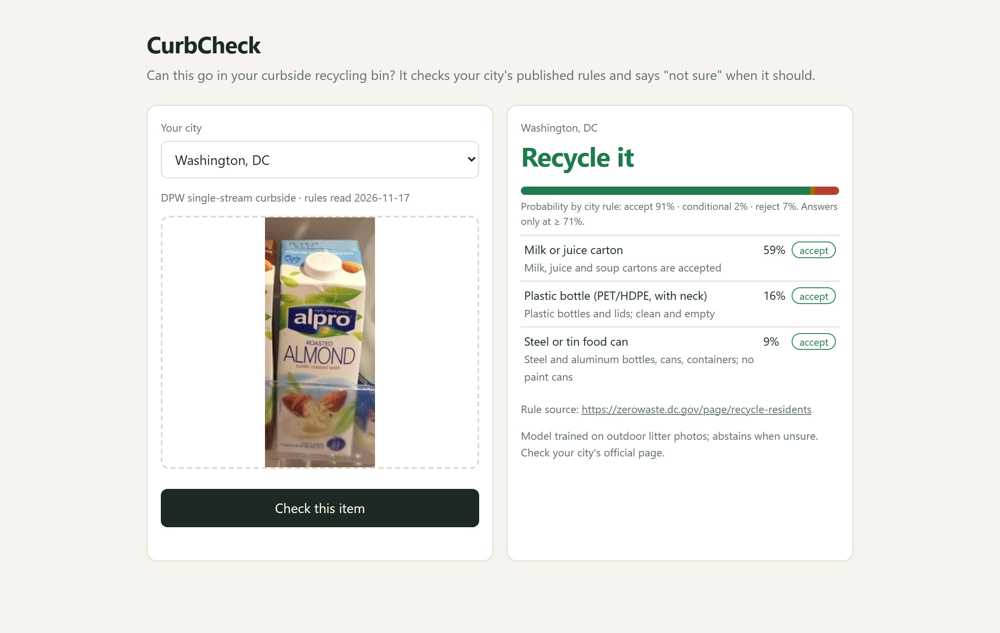
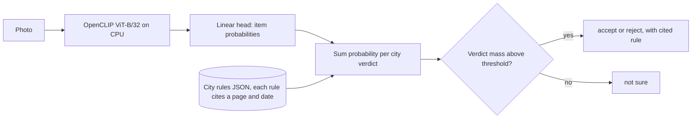



# CurbCheck

**Try it:** https://jean-regis-m.github.io/curbcheck/ (runs entirely in your browser; first load downloads a ~90 MB model, then it is cached) · **Demo video:** https://youtu.be/8sTgR-G_Jro · [Technical report (PDF)](docs/report/report.pdf)

Can this item go in my curbside recycling bin, **in my city**? CurbCheck identifies an item from a photo, looks up the
city's published rules, and answers **accept**, **reject** or **not sure**. A wrong "accept" contaminates a whole load,
so it abstains instead of guessing. Research prototype for Arbiter Hacks V1 (Theme Track: Rethinking Waste).

## What is implemented
- Rules engine: per-city JSON tables where every rule cites an official page and retrieval date (Seattle, Washington DC, New York City).
- Image model: OpenCLIP ViT-B/32 (CPU) plus a linear head trained on TACO litter crops and RealWaste landfill photos, 14 item types.
- Abstention: temperature-scaled probabilities are summed per city verdict; the tool answers only above a threshold chosen on a validation split.
- FastAPI service (/api/check, /api/cities) and a single-page web UI.
- Tests (pytest), lint (
uff), reproducible data and evaluation scripts.

## Screenshots
All captured from the running app (`scripts/capture_screenshots.py`). Photos are TrashNet (MIT) and one TACO crop.

| | |
|---|---|
|  **Home.** Pick a city, add a photo. |  **Accept.** A glass bottle in Seattle, with the matching rule and its source link. |
|  **Abstention.** Cardboard at 65% accept mass is below the 71% threshold, so the answer is "not sure". |  **Reject.** Trash is not recyclable in Seattle. |
|  **Same photo, Seattle.** The city page does not name cartons, so the rule is conditional: "not sure". |  **Same photo, Washington DC.** DC lists cartons, so the answer is "recycle it". |

## How it works

## API
`GET /api/cities`, `GET /api/health`, `POST /api/check` (multipart: `image` JPEG/PNG/WebP up to 5 MB, `city`).
Returns the verdict, per-verdict probabilities, top 3 items with their rules, and the rule source URL.

## Measured results
Two heads are in the repo. **v1 is shipped** (`models/head.npz`, identical to `models/head_v1.npz`); v2 is `models/head_v2.npz`. See the TrashNet result below for why.
"False accept" = told "recycle it" when the city's rule for the true item is not "accept" (conditional counts).
"Missed recyclable" = a genuinely accepted item told "not recyclable". Thresholds were chosen on validation data only.

**v1: trained on TACO only** (TACO test n=306, split by source photo; eval/fixed_threshold.json)

| City | False-accept, forced yes/no | False-accept, abstaining | Coverage |
|---|---|---|---|
| Seattle | 13.8% | 3.3% | 69.6% |
| Washington DC | 12.2% | 3.2% | 68.6% |

v1 on RealWaste, which it had never seen (eval/realwaste.json, 1,200 images): false accepts 0.8 to 1.2%, **but 30% of
recyclable items were told "not recyclable"** (forced yes/no: 51 to 57%).

**v2: adds RealWaste material labels** (weak labels: cardboard, paper, glass, food, other; metal resolved by v1; plastic excluded).
RealWaste was split 50/25/25 by image; v2 never saw the test part (n=960, eval/v2.json).

| Held-out set | Model | False-accept | Missed recyclable | Coverage |
|---|---|---|---|---|
| RealWaste test | v1 | 1.4% | 29.8% | 70% |
| RealWaste test | v2 | 1.7% (95% CI 0.7 to 3.0) | 2.2% (1.1 to 3.5) | 82% |
| TACO test | v1 | 3.3% | 10.4% | 70% |
| TACO test | v2 | 2.0% (0 to 4.4) | 1.9% (0 to 4.4) | 39% |

(Seattle shown; DC and NYC are within a point or two, see eval/v2.json.)

**How to read the v2 numbers honestly.** The RealWaste gain is adaptation to that dataset, not generalisation: v2 saw other
RealWaste photos, so this is no longer an unseen-dataset result. On TACO, v2 abstains much more often (39% vs 70%
coverage) because its threshold was chosen on a validation pool dominated by easier RealWaste images, and its forced
yes/no false-accept rate on TACO is worse (17% vs 14%). The TrashNet test below was run for exactly this reason and does not support v2.

**Unseen-dataset test on TrashNet** (studio photos, MIT licence, 2,045 images: cardboard, glass, metal, paper accepted;
only 137 "trash" images as non-recyclable; plastic excluded; eval/trashnet.json). Seattle shown, DC and NYC are similar.

| Head | False-accept (abstaining) | Forced yes/no | Missed recyclable | Coverage |
|---|---|---|---|---|
| v1 | 5.8% (95% CI 2.2 to 9.4) | 20.4% | 9.1% | 70% |
| v2 | 12.4% (7.1 to 17.6) | 51.8% | 0.2% | 77% |

On data neither head has seen, v2 is the less safe one: it accepts about one in eight non-recyclable items and, when
forced to choose, about half of them. Training on RealWaste taught it to say "recyclable" too readily. Because a false accept
(contamination) is the costlier mistake, **v1 is the default**. The trade is real: v1 wrongly rejects roughly 9% to 30% of
recyclables depending on the dataset. Neither head is good enough for deployment; closing this gap needs real
item-level labels, not weak material labels.

### The hosted demo uses a separate, browser-native model
GitHub Pages cannot run the Python server, so the hosted demo runs OpenAI CLIP ViT-B/32 (int8 ONNX) with transformers.js
in the visitor's browser. Its image features differ from the PyTorch ones (mean cosine similarity 0.83, measured), so it
has its own head, trained and thresholded on browser-computed features of the same TACO split (`models/head_web.npz`,
`eval/fixed_threshold_web.json`). On the TACO test split (306 crops, Seattle): false-accept 17.1% forced vs 3.9% abstaining at
65.7% coverage, with 11.7% of recyclables wrongly rejected (PyTorch v1: 13.8% vs 3.3% at 69.6%, 10.4%). It was not re-run on
TrashNet or RealWaste, so the unseen-dataset results below apply to the PyTorch heads only.

### What did not work
We hypothesised that abstaining on the probability of the *city verdict* would beat abstaining on *item confidence*.
It did not: the two perform about the same (zero-shot: worse). The benefit comes from abstention itself and from tying answers to city rules.

## Limitations (read before trusting it)
- Trained on TACO (outdoor litter) and RealWaste (landfill, material-level labels). TACO test set is small (306 crops, wide intervals). No fully unseen dataset test for v2 and no household photos.
- Batteries and greasy pizza boxes had too few examples (2 and 3) so the model cannot predict them, although the rules tables include them. Food waste comes only from RealWaste's weak labels.
- 330 TACO annotations were dropped because photo orientation disagreed with the annotation.
- Three cities only. Where a city page is silent on an item the rule is marked conditional (never auto-answered); that is a gap in the page, not a statement of the city's actual rule.
- Not a substitute for your city's official guidance.

## Run it locally (PyTorch model and API)
`ash
python -m venv .venv
.venv/Scripts/python -m pip install -e ".[dev]" open_clip_torch torch torchvision scikit-learn matplotlib requests --extra-index-url https://download.pytorch.org/whl/cpu
.venv/Scripts/python -m pytest
.venv/Scripts/python -m uvicorn curbcheck.api:app --port 8000   # open http://localhost:8000
`
(On macOS/Linux use .venv/bin/python.) The first request downloads the OpenAI CLIP weights.

Reproduce the evaluation (downloads TACO images from the dataset's own host; images are never committed):
`ash
python scripts/prepare_taco.py && python scripts/extract_features.py && python scripts/evaluate.py && python scripts/train_head.py   # v1
python scripts/extract_realwaste.py && python scripts/train_v2.py   # v2 (writes models/head_v2.npz; copy to models/head.npz to ship)
# RealWaste check needs pyarrow and the two parquet shards from the HuggingFace mirror shahzaibvohra/realwaste placed in data/raw/realwaste/ as p0.parquet and p1.parquet
python scripts/eval_realwaste.py
`

See docs/ARCHITECTURE.md and docs/DATA.md (data sources, licences, unresolved conflicts). Code is MIT licensed; datasets keep their own licences.

## Hosted demo build
`python scripts/build_site.py` assembles `_site/` (UI, in-browser engine, head weights, city rules); `.github/workflows/pages.yml` publishes it.
To refresh the browser head: serve `_site`, run `scripts/extract_browser_features.py taco OUT.json`, save the features as `data/cache/taco_web_q8.npy`, then
`CURBCHECK_FEATURES=taco_web_q8.npy CURBCHECK_HEAD=head_web python scripts/train_head.py`.
