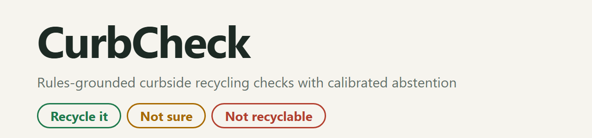
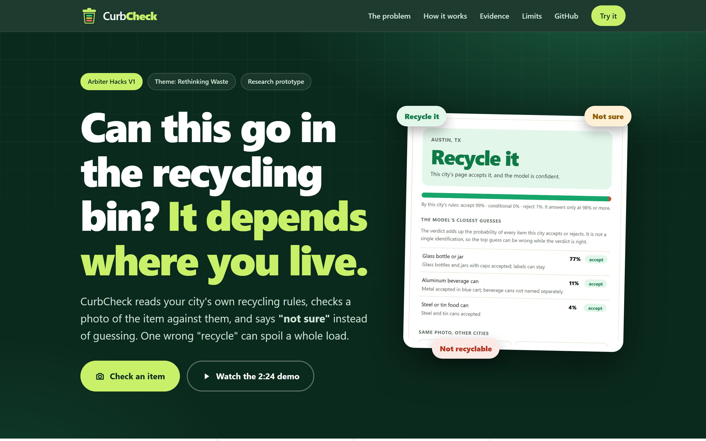
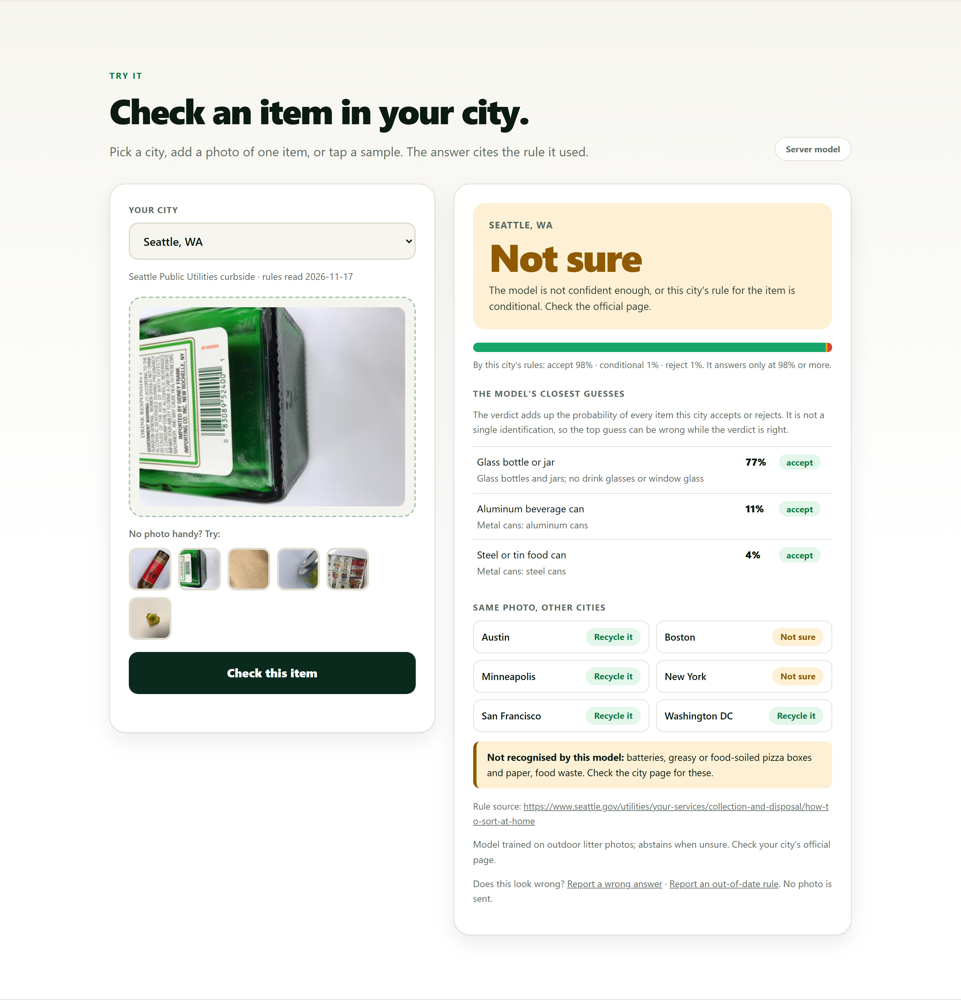
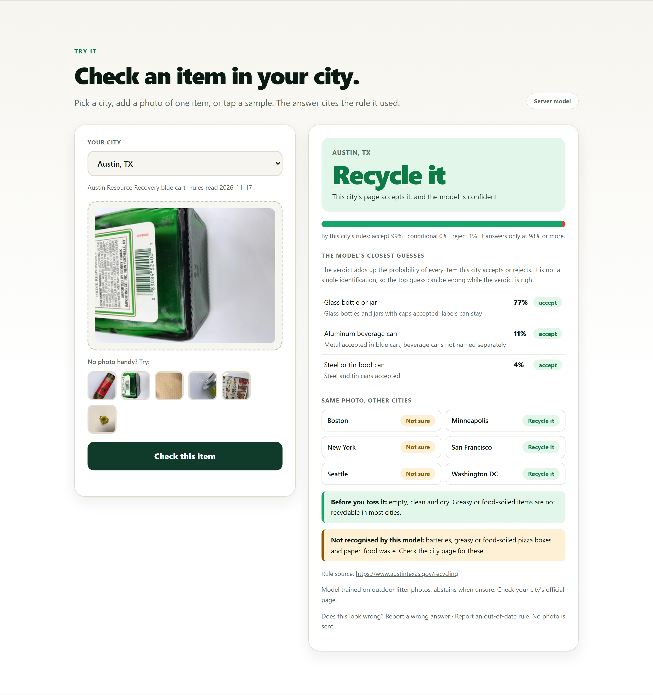
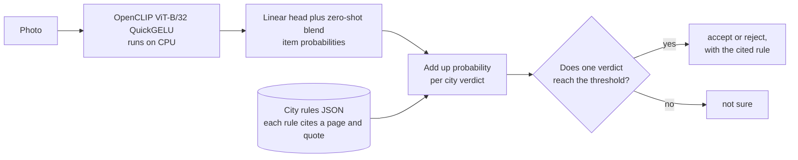

<div align="center">



[](https://github.com/Jean-Regis-M/curbcheck/actions/workflows/ci.yml)
[](https://jean-regis-m.github.io/curbcheck/)
[](https://youtu.be/UxmwYp9BlHo)
[](LICENSE)

**A recycling checker that knows your city's rules, and says "not sure" instead of guessing.**

[Try it in your browser](https://jean-regis-m.github.io/curbcheck/) ·
[Watch the 2 minute 24 second demo](https://youtu.be/UxmwYp9BlHo) ·
[Read the technical report (PDF)](docs/report/report.pdf)

*Arbiter Hacks V1, Theme Track: Rethinking Waste*

</div>

---

## The one idea

Put one wrong item in a recycling bin and a whole load can be spoiled. The expensive mistake is the **false accept**: telling someone "recycle it" about something their city will not take.

Most "is this recyclable?" tools give one national yes or no. The answer is local. CurbCheck covers **seven US cities**, and these are real differences between them, each read from the city's own page:

| Item | Seattle | Washington DC | New York | Austin | Minneapolis | Boston | San Francisco |
|---|---|---|---|---|---|---|---|
| Milk or juice carton | page silent | accept | accept | accept | accept | page silent | accept |
| Coffee cup (plastic lined) | page silent | page silent | page silent | accept | **reject** | page silent | accept |
| Greasy pizza box | **reject** (compost) | page silent | page silent | page silent | page silent | page silent | **reject** (compost) |
| Aluminum foil | accept | page silent | accept | accept | accept | accept | accept |
| Plastic tub | accept | accept | ice cream tubs excluded | accept | accept | accept | accept |

Six of the sixteen items in the taxonomy get different answers somewhere in this set. CurbCheck turns that into a tool with two rules:

1. **The answer comes from the city's published rule, and shows its source.** Every rule carries the URL of the official page and the date it was read, and 96 of the 112 rules carry a **verbatim quote** from that page. An audit script re-fetches the pages and re-checks 83 of those quotes automatically (every city except New York, whose site blocks scripts); New York's 13 were checked by hand.
2. **It only answers when it is confident enough.** Otherwise it says *not sure*. It also says *not sure* when the city's page is silent about the item.

The second rule is the product, and the shipped model is deliberately cautious:

On photos from two datasets it never saw, it wrongly accepts about 2% to 7% of non-recyclable items and wrongly rejects about 0% of recyclable ones, but it answers only about 60% to 70% of studio photos and about 25% to 30% of landfill photos. (Tables below; the hosted browser model is a little worse.)

That is a trade, stated plainly: it says "not sure" often. A "not sure" costs a resident one look at the city's own page; a wrong "recycle it" can spoil a whole load.

## For judges: the three-minute path

1. **Try it.** Open the [live page](https://jean-regis-m.github.io/curbcheck/) and tap a sample photo. The first visit downloads a 90 MB model once; after that it is cached and nothing leaves your device.
2. **Check the claims.** Every table in this README is regenerated by a script and compared against `eval/*.json` in CI (`python scripts/check_claims.py`). The city rules carry verbatim quotes that `python scripts/verify_rules.py` re-checks against the live pages.
3. **Try to break it.** [`docs/GAPS.md`](docs/GAPS.md) lists what is known to be missing, with its status. The serious ones: the cautious model answers only a minority of litter and landfill photos, there is still no household-photo test, and a greasy pizza box can be mistaken for clean cardboard.

How the design follows what judges and past winners say, with sources and an honest status for each point: [`docs/WINNING_TRAITS.md`](docs/WINNING_TRAITS.md). How impact would actually be measured, with sample sizes: [`docs/PILOT.md`](docs/PILOT.md).

## See it work

| | |
|---|---|
|  **The landing page** a visitor sees first. Nothing is uploaded when you use the hosted demo. |  **A confident answer.** A glass bottle in Seattle: recycle it, with the matching rule and its source link. |
|  **A deliberate "not sure".** Cardboard is a close call between several items, so it declines and says why. |  **A clear no.** An apple core is not recyclable in Seattle. |
|  **Same photo, Seattle.** The model is split between items that Seattle's page treats differently, so: "not sure". |  **Same photo, Austin.** Austin's rules leave no doubt about any of the likely items: "recycle it". |

The hosted demo also shows the verdict in every other city for the same photo.

## The evidence, including what went wrong

Every number below comes from a script in this repository and a JSON file you can open; CI fails if this README and those files disagree. Small test sets mean wide error bars; they are stated, not hidden. A separate AI-agent review of the first version found real problems (see [what the review found](#what-a-separate-ai-agent-review-found-and-what-changed)); this section reflects the fixed models.

### The shipped model

One OpenCLIP image encoder and a classifier trained on **three public datasets** (TACO litter crops, TrashNet studio photos, RealWaste landfill photos), with a zero-shot CLIP text blend, temperature scaling, and an abstention threshold chosen on validation data (it answers only when one verdict holds about 98% of the probability). I chose it over the earlier TACO-only model because that model wrongly rejected 8% to 33% of recyclable items on photo domains it had not seen.

**Photos from a dataset it has never seen.** Leave-one-dataset-out: train without that dataset, then test on all its non-plastic photos (plastic is excluded because bottles and bags get different verdicts; truth is material-level, see [`docs/DATA.md`](docs/DATA.md)). The "earlier model" is the TACO-only model scored on exactly the same photos. ([`eval/v3.json`](eval/v3.json), [`scripts/train_v3.py`](scripts/train_v3.py))

<!-- block:summary:start -->
On photos from a dataset it never saw, the shipped model wrongly accepts 2.2% to 6.6% (TrashNet) and 1.8% to 2.9% (RealWaste) of non-recyclable items, and wrongly rejects 0.00% to 0.00% and 0.00% to 0.05% of recyclable ones. The earlier TACO-only model wrongly rejected 8.1% to 8.8% and 29.7% to 32.6%. The price: it answers 61% to 69% of TrashNet photos and 24% to 31% of RealWaste photos, against 56% to 72% and 66% to 73% for the earlier model.
<!-- block:summary:end -->

*TrashNet (2,527 studio photos), unseen:*

<!-- block:unseen-trashnet:start -->
| City | False accepts, forced yes/no | False accepts, shipped model | Recyclables wrongly rejected, shipped | Share answered, shipped | False accepts, earlier model | Recyclables wrongly rejected, earlier | Share answered, earlier |
|---|---|---|---|---|---|---|---|
| Seattle | 61.3% | **2.9%** | 0.00% | 65.5% | 3.6% | 8.1% | 65.4% |
| Washington DC | 58.4% | **2.2%** | 0.00% | 62.6% | 4.4% | 8.1% | 67.1% |
| New York City | 62.0% | **2.9%** | 0.00% | 61.3% | 1.5% | 8.1% | 55.5% |
| Austin | 65.0% | **6.6%** | 0.00% | 68.9% | 9.5% | 8.1% | 71.7% |
| Minneapolis | 64.2% | **2.9%** | 0.00% | 67.3% | 5.1% | 8.8% | 69.4% |
| Boston | 61.3% | **2.9%** | 0.00% | 65.5% | 3.6% | 8.1% | 65.4% |
| San Francisco | 62.0% | **6.6%** | 0.00% | 68.9% | 9.5% | 8.1% | 71.7% |
<!-- block:unseen-trashnet:end -->

*RealWaste (4,752 landfill photos), unseen:*

<!-- block:unseen-realwaste:start -->
| City | False accepts, forced yes/no | False accepts, shipped model | Recyclables wrongly rejected, shipped | Share answered, shipped | False accepts, earlier model | Recyclables wrongly rejected, earlier | Share answered, earlier |
|---|---|---|---|---|---|---|---|
| Seattle | 35.4% | **2.7%** | 0.00% | 29.7% | 1.1% | 29.7% | 69.8% |
| Washington DC | 32.7% | **1.8%** | 0.00% | 24.3% | 1.1% | 29.7% | 68.8% |
| New York City | 35.2% | **2.5%** | 0.00% | 29.1% | 0.7% | 29.7% | 65.9% |
| Austin | 36.0% | **2.9%** | 0.00% | 31.5% | 2.0% | 29.7% | 73.4% |
| Minneapolis | 35.1% | **2.7%** | 0.05% | 30.3% | 1.3% | 32.6% | 73.0% |
| Boston | 35.4% | **2.7%** | 0.00% | 29.7% | 1.1% | 29.7% | 69.8% |
| San Francisco | 36.0% | **2.9%** | 0.00% | 31.5% | 2.0% | 29.7% | 73.4% |
<!-- block:unseen-realwaste:end -->

**Read these with two caveats.** First, I chose the zero-shot weight and the answer-rate target (about 55%) *after* looking at these two unseen tests, so the shipped numbers here are optimistic. Second, "recyclables wrongly rejected" near zero is partly bought by abstaining: on RealWaste the model declines most photos. A "not sure" is a safe answer, not a correct one.

**Parts of the training datasets that were held out and not used to choose anything** (Seattle shown; every city is in [`eval/v3.json`](eval/v3.json)):

<!-- block:in-domain:start -->
| Held-out part (Seattle) | False accepts, forced yes/no | False accepts, shipped | Recyclables wrongly rejected | Share answered |
|---|---|---|---|---|
| TACO litter photos (306 crops) | 21.7% | **0.0%** | 0.00% | 19.6% |
| TrashNet studio photos | 42.9% | **0.0%** | 0.00% | 73.7% |
| RealWaste landfill photos | 8.2% | **1.2%** | 0.00% | 62.4% |
<!-- block:in-domain:end -->

On litter photos (TACO) the shipped model is far more cautious than the earlier one: it answers few of them. Outdoor litter is not the use case, but it is the harder one, and the cost is real.

### The hosted demo's model

GitHub Pages cannot run Python, so the hosted page runs CLIP in the browser (int8, transformers.js). Its image features match PyTorch's only partly (mean cosine similarity 0.88 to 0.90), so it has its own head, trained on features computed by the browser pipeline with the same recipe, and tested the same way on unseen datasets (false accepts / recyclables wrongly rejected / share answered; [`eval/v3_web.json`](eval/v3_web.json)):

<!-- block:web:start -->
| City | TrashNet (unseen): false accepts / recyclables wrongly rejected / answered | RealWaste (unseen): false accepts / recyclables wrongly rejected / answered |
|---|---|---|
| Seattle | 4.4% / 0.16% / 60% | 3.0% / 0.00% / 31% |
| Washington DC | 4.4% / 0.16% / 58% | 1.8% / 0.00% / 25% |
| New York City | 4.4% / 0.16% / 55% | 2.9% / 0.00% / 31% |
| Austin | 10.9% / 0.16% / 65% | 3.3% / 0.00% / 33% |
| Minneapolis | 5.1% / 0.16% / 62% | 3.0% / 0.09% / 32% |
| Boston | 4.4% / 0.16% / 60% | 3.0% / 0.00% / 31% |
| San Francisco | 10.9% / 0.16% / 65% | 3.3% / 0.00% / 33% |
<!-- block:web:end -->

The two models can disagree on a single photo. A 360-case test ([`tests/test_js_parity.py`](tests/test_js_parity.py)) checks that the browser's decision code gives exactly the same answers as the Python code for the same probabilities.

### More measurements

<!-- block:extras:start -->
- **Same photo, different answers.** Across the seven cities, the answer is not the same for 7% of TrashNet photos, 19% of RealWaste photos and 5% of held-out TACO crops. Most of these are "recycle it" in one city and "not sure" in another (the page is silent); one city saying "recycle it" while another says "not recyclable" happens for 0.7% of TACO crops, 0.0% of TrashNet and 0.0% of RealWaste.
- **The three item types without enough training data** (tiny smoke test, not evidence): of the answers over all seven cities, 0 of 14 for the 2 battery crops and 0 of 35 for the 5 food-waste crops were wrongly "recycle it"; for the 3 greasy pizza boxes it was 7 of 21 (33%), because a greasy box can look like clean cardboard.
- **Speed.** On this laptop CPU (no GPU) the PyTorch model takes a median of 166 ms per photo (95th percentile 295 ms, 100 photos); in the browser, with the model loaded, a median of 0.6 s from choosing a photo to the verdict (12 photos).
<!-- block:extras:end -->

### The earlier TACO-only model (kept for comparison)

`models/head_v1.npz` is the first model: trained on TACO only, threshold chosen to answer about 70% of questions. Its results are below, with the same protocol as before.

**Earlier model: held-out TACO test.** 306 item crops, split by source photo so the same photo never appears in training and testing. The abstention threshold was chosen on a separate validation split. ([`eval/fixed_threshold.json`](eval/fixed_threshold.json))

| City | False accepts, forced yes/no | False accepts, with abstention | Share answered | Accept precision | False accepts (count) |
|---|---|---|---|---|---|
| Seattle | 15.8% | **3.3%** | 69.0% | 94.8% | 5 of 152 |
| Washington DC | 12.8% | **1.9%** | 67.6% | 96.8% | 3 of 156 |
| New York City | 12.5% | **2.6%** | 68.3% | 95.8% | 4 of 152 |
| Austin | 10.3% | **0.7%** | 72.2% | 99.1% | 1 of 136 |
| Minneapolis | 12.3% | **3.4%** | 70.9% | 95.0% | 5 of 146 |
| Boston | 15.8% | **3.3%** | 69.0% | 94.8% | 5 of 152 |
| San Francisco | 10.3% | **0.7%** | 72.2% | 99.1% | 1 of 136 |

*False accept: the tool said "recycle it" and the city's rule for the true item is not "accept" (conditional counts as not accept). Accept precision: of the items it told people to recycle, the share that really are accepted. The counts are small, one to five events per city, so treat the percentages as indicative.*

**Earlier model: TrashNet.** 2,045 non-plastic studio photos, only 137 of them non-recyclable. ([`eval/trashnet.json`](eval/trashnet.json))

| City | Non-recyclables wrongly accepted | 95% interval | Forced yes/no | Recyclables wrongly rejected | Answered |
|---|---|---|---|---|---|
| New York City | 1.5% (2 of 137) | 0.0 to 3.6 | 11.7% | 8.1% | 56% |
| Seattle | 3.6% (5 of 137) | 0.7 to 7.2 | 16.8% | 8.1% | 65% |
| Boston | 3.6% (5 of 137) | 0.8 to 6.9 | 16.8% | 8.1% | 65% |
| Washington DC | 4.4% (6 of 137) | 1.4 to 7.9 | 16.1% | 8.1% | 67% |
| Minneapolis | 5.1% (7 of 137) | 2.2 to 9.1 | 14.6% | 8.8% | 69% |
| Austin | 9.5% (13 of 137) | 4.7 to 14.1 | 17.5% | 8.1% | 72% |
| San Francisco | 9.5% (13 of 137) | 4.9 to 14.2 | 17.5% | 8.1% | 72% |

Here the city rules matter for safety, not only for the answer: Austin and San Francisco accept more item types (for example coated paper cups), so more of TrashNet's "trash" photos are wrongly accepted there than in New York. Accept precision looks excellent here only because about 93% of these photos are recyclable, so it is not a useful number on this dataset; the false-accept rate is. The intervals treat photos as independent although TrashNet contains near-duplicates, so they are optimistic.

**Earlier model: robustness over 20 random splits.** One 306-crop test set is a thin basis, so the whole TACO set (1563 crops) was re-split by source photo 20 times (60/20/20, threshold chosen on each split's validation part only). Mean and standard deviation across splits ([`scripts/crossval.py`](scripts/crossval.py), [`eval/crossval.json`](eval/crossval.json)):

| City | False accepts, forced yes/no | False accepts, with abstention | Share answered | Accept precision |
|---|---|---|---|---|
| Seattle | 13.8 ± 3.1% | 2.2 ± 1.3% | 67.6 ± 4.7% | 95.5 ± 2.9% |
| Washington DC | 12.7 ± 2.5% | 2.4 ± 1.2% | 67.9 ± 4.4% | 95.1 ± 2.5% |
| New York City | 12.5 ± 2.6% | 1.7 ± 1.0% | 67.5 ± 4.6% | 96.6 ± 2.0% |
| Austin | 10.5 ± 2.6% | 2.8 ± 1.4% | 72.5 ± 4.6% | 95.6 ± 2.1% |
| Minneapolis | 10.9 ± 2.3% | 2.3 ± 1.2% | 71.2 ± 4.8% | 95.7 ± 2.3% |
| Boston | 13.8 ± 3.1% | 2.2 ± 1.3% | 67.6 ± 4.7% | 95.5 ± 2.9% |
| San Francisco | 10.5 ± 2.6% | 2.8 ± 1.4% | 72.5 ± 4.6% | 95.6 ± 2.1% |

Calibration (earlier model): temperature scaling lowers the item head's expected calibration error from 9.8% to 6.6%.

**Earlier model: controlling the risk instead of tuning a threshold.** The same script picks the lowest threshold whose validation false-accept rate is provably at most alpha with 90% confidence (fixed-sequence testing with one-sided Clopper-Pearson bounds), then checks it on held-out photos:

| Target alpha | Splits where a threshold was found | Share answered | False-accept rate on held-out photos | Held-out rate above alpha |
|---|---|---|---|---|
| 2% | 99% | 38.1 ± 17.1% | 0.5 ± 0.7% | 3.6% |
| 5% | 100% | 71.0 ± 8.7% | 2.7 ± 1.7% | 10.0% |
| 10% | 100% | 87.7 ± 6.4% | 6.7 ± 3.0% | 13.6% |

The guarantee assumes validation and test photos are exchangeable, which holds inside TACO and not across datasets. At alpha of 10% the held-out rate exceeded alpha slightly more often than the nominal 10%; the seven cities reuse the same photos, so these runs are not independent. Read this as a way to dial safety against coverage, not as a deployment guarantee.

**Five things I tried that did not hold up on the first attempt.** I kept them because they changed what I shipped.

| What I tried | What happened | What I did |
|---|---|---|
| Abstain on the probability of the city's *verdict* instead of on item confidence, expecting a gain. | About the same with the trained model, worse with zero-shot features, across all seven cities. ([`eval/results.json`](eval/results.json)) | Dropped the claim that this is the contribution. The gain comes from abstention itself and from tying answers to city rules. |
| Add RealWaste landfill photos (model "v2"). | Wrongly rejected recyclables fell from 31% to 2% on held-out RealWaste photos, but that was adaptation: on unseen TrashNet it wrongly accepted 14% to 19% of non-recyclables. ([`eval/v2.json`](eval/v2.json)) | Did not ship v2. It was the first sign of a prior shift: the added datasets are 70% to 93% recyclable. |
| Train on all three datasets with the original 70% answer target. | Wrongly rejected recyclables fell to about 0%, but false accepts on unseen datasets rose to 9% to 17%. ([`eval/v3_first_sweep.json`](eval/v3_first_sweep.json)) | Swept the answer-rate target and class weights; a stricter target (about 55%) with a zero-shot blend kept false accepts near the earlier model's level. The shipped model is this one, and it is the one tuned after looking at the unseen tests. |
| Run the same model in the browser for the hosted demo. | Browser image features match PyTorch's only partly (int8 quantisation and a different image resizer). My first port disagreed with the Python model on 13 of 60 images. | Retrained the classifier on features computed by the browser pipeline itself, and report its own numbers above. |
| Use the OpenCLIP encoder as I first set it up. | A separate AI reviewer agent found I had loaded the OpenAI weights without the QuickGELU activation they were trained with. | Fixed it, re-extracted every feature, retrained and re-ran every evaluation. |

## What a separate AI-agent review found, and what changed

The reviewer is a separate **AI agent** I commissioned, not a human. I had it play four skeptical judges (engineer, ML, practitioner, presentation) and review the API's security, without my guidance. It scored the first version about 62 out of 100 and listed verified defects; after the fixes a second review scored the next version about 71 out of 100 and found more. The full texts are kept privately; this is what I did about each finding:

| Finding | Change |
|---|---|
| Wrong CLIP activation in the PyTorch path | Fixed and every result regenerated (above). |
| Three high-stakes items (batteries, greasy or food-soiled paper, food waste) are not recognised by the model, so a greasy pizza box can be called cardboard | Every answer now lists these as "not recognised by this model", and "recycle it" answers carry a clean, empty and dry reminder. I did not solve the underlying gap: it needs labelled examples I do not have. |
| Headline rate rested on few events, and the denominator included abstained items | The tables now show the event counts and accept precision (the share of "recycle it" answers that are right). |
| TrashNet is not a clean holdout (v1 versus v2 was chosen after seeing it; near-duplicate photos) | Stated in [`docs/DATA.md`](docs/DATA.md) and above. |
| Hosted demo is not the evaluated model | Described openly above; it has its own measured head. |
| Upload limits did not do what the README said: a 49 megapixel image was accepted, the 5 MB cap applied only after parsing, inference blocked the server's event loop | Oversized bodies are rejected before parsing, the pixel limit is checked from the image header, inference runs in a worker thread, and there is a per-client rate limit of 30 checks a minute. Four new tests cover these. |
| Stale architecture notes and an unsupported "checksums" claim | Rewritten. |
| Rule data is hard to trust | Added verbatim quotes and an audit script (below). |
| Round 2: the "92 ms per photo" figure had no script behind it, and real speed was higher | Added `scripts/benchmark_latency.py` and replaced the claim with the measured numbers (see More measurements). |
| Round 2: "96 of 112 rules re-checked by script" overstated; New York's 13 cannot be machine-checked | Now stated as 83 re-checked automatically and 13 by hand, and the page figure is computed from the rule files. |
| Round 2: the explanation panel could show a wrong top item (a paper photo listed "steel can") | The panel now says the verdict adds up all similar items and the top guess can be wrong; accept answers on cardboard or paper carry a specific greasy-pizza-box warning. |
| Round 2: no test connected the browser code to the Python code or ran the real model | Added a 360-case JS-versus-Python parity test and real-model tests on the sample photos. |
| Round 2: the demo video and sample photos did not show a cross-city difference | Added a TrashNet photo whose answer differs by city, and re-recorded the video. |
| Round 2: the "independent review" was an AI agent | Said so, here and on the page. |

## How it works



**Rules.** Each city is a JSON file over a 16-item taxonomy. A rule is `accept`, `reject` or `conditional`. *Conditional* means the city's page does not cover the item; the system never auto-answers it. Tables are validated by pydantic: every item must be covered and every rule must cite a source; a test requires every `accept` rule to carry a verbatim quote. ([`data/rules/`](data/rules), [`src/curbcheck/rules.py`](src/curbcheck/rules.py))

```json
"milk_carton": { "verdict": "accept",
                 "note": "Milk, juice and soup cartons are accepted",
                 "source": 0,
                 "quote": "Milk, Juice, & Soup Cartons" }
```

**Rule audit.** `python scripts/verify_rules.py` fetches every cited page (falling back to a headless browser) and checks each quote is still present; a monthly GitHub workflow runs it. All quotes for Seattle, Washington DC, Austin, Minneapolis, Boston and San Francisco pass. New York's site blocks scripted clients, so its quotes were checked by hand against the page on the day I read it.

**Decision.** The classifier gives a probability for each item. Items are grouped by what *this city* says about them, and each group's probabilities are added. The tool answers `accept` or `reject` only if one group's total reaches the threshold; otherwise `not sure`. ([`src/curbcheck/decision.py`](src/curbcheck/decision.py))

**Model.** OpenAI CLIP ViT-B/32 through OpenCLIP, plus a logistic-regression head over 14 item classes trained on three datasets, blended with CLIP's zero-shot text similarity, and temperature-scaled on a validation split. It runs on a CPU; measured speed is under More measurements. Weak material-level labels from TrashNet and RealWaste are described in [`docs/DATA.md`](docs/DATA.md).

## Judging criteria, answered one by one

The Theme Track rubric from the [Devpost rules](https://arbiter-hacks-v1.devpost.com/rules), with the evidence for each criterion and the gap I would point to myself.

### Impact on the waste problem (35)
- **Central, not bolted on.** The whole product is the contamination decision at the bin. Remove the rules and nothing is left.
- **Measured, within limits.** On photos from two datasets it never saw, the shipped model wrongly rejects almost no recyclables and keeps false accepts to a few percent, by answering less often (tables above). Seven cities' rules change the answer for 5% to 19% of photos.
- **How I would measure whether it worked in the real world.** Pick two comparable buildings or routes, give one the tool, audit bins before and after, and weigh non-recyclables found in the recycling stream. The target is contamination by weight, with the tool's false-accept rate as the leading indicator. **I have not run this.** I make no claim about tonnes diverted or money saved.
- **Gap.** Curbside only, seven cities, no household-photo data.

### Technical execution (25)
- **Quality.** 32 automated tests (rule validation, quote requirements, decision logic, API behaviour including oversized uploads, pixel bombs and rate limiting), ruff, and [CI](https://github.com/Jean-Regis-M/curbcheck/actions) on every push. A fresh clone installs, passes the tests and builds the site.
- **Difficulty.** A rules-grounded decision layer; a rule-audit pipeline that re-checks 83 quotes automatically against live pages (13 more by hand); a three-dataset, seven-city evaluation split by source photo; three model generations compared with leave-one-dataset-out tests; a browser-native port whose feature mismatch I diagnosed and corrected; and a separate AI-agent review whose findings I fixed and re-measured.
- **Reproducible.** Every number regenerates from [`scripts/`](scripts). Datasets download by script and are never committed.
- **Gap.** Weak material-level labels for two of the three training datasets, small test sets, and no household-photo data.

### Feasibility (20)
- **Runs cheaply.** CPU only; speed is measured and reported above. The hosted demo needs no server: the model runs in the visitor's browser and the photo stays on their device.
- **Rules are data, not code.** Adding a city is one JSON file with cited, quoted sources, validated and auditable.
- **What blocks real deployment, plainly.** (1) Item-level labelled household photos. The shipped model is safe partly because it declines most hard photos, which is not yet a good product. (2) Batteries and greasy paper are not recognised, and greasy pizza boxes can pass as cardboard. (3) Keeping rules current. (4) Image dataset licences are unresolved (see [Data](#data-and-licences)).

### Presentation and demo clarity (20)
- A 2 minute 24 second [video](https://youtu.be/UxmwYp9BlHo) recorded from the real running app after the review fixes, including a "not sure" case and the measured trade-offs. The narration is a synthetic voice.
- A live demo a judge can try in one click, with sample photos.
- This README, a [3 page report](docs/report/report.pdf), and every claim linked to its evidence file.

## Questions I would ask if I were judging this

**Why not just ask a large language model?** Its answer would not cite the city's page, could not be audited against a rule table, and would not be measurable as a false-accept rate.

**Are the error rates good?** On photos from datasets it never saw, a few percent of non-recyclables are wrongly accepted, depending on the city, against tens of percent when the model is forced to answer. That is a clear improvement from abstaining, not a deployable error rate: the sets are small and the labels are weak.

**Why does it decline so often?** On photos from a dataset it has not seen it often says "not sure" (see the "share answered" columns). That is the price of near-zero wrongly rejected recyclables and a few percent of false accepts, and it is adjustable: the answer-rate target is one number chosen on validation data, and the sweep that chose it is in `eval/v3.json`.

**How do you know the rules are right?** Each rule cites an official page and, where the page speaks, quotes it. A script re-checks the quotes against the live pages. A rule can still be misread or go stale, which is why every answer links to its source.

**What did you get wrong?** The five experiments above, including an encoder setting a separate AI reviewer agent caught. They stay in the README because a prototype that hides its failures cannot be trusted.

## Run it yourself

The hosted demo needs nothing. To run the full Python model and API locally:

```bash
git clone https://github.com/Jean-Regis-M/curbcheck.git
cd curbcheck
python -m venv .venv
.venv/Scripts/python -m pip install torch torchvision --index-url https://download.pytorch.org/whl/cpu
.venv/Scripts/python -m pip install -e ".[dev]" open_clip_torch
.venv/Scripts/python -m pytest
.venv/Scripts/python -m uvicorn curbcheck.api:app --port 8000
```

On macOS or Linux use `.venv/bin/python`. Open `http://localhost:8000`. The first request downloads the OpenAI CLIP weights.

Rebuild the evaluation (scripts download the datasets themselves; images are never committed):

```bash
pip install scikit-learn matplotlib requests pyarrow
python scripts/prepare_taco.py && python scripts/extract_features.py
python scripts/evaluate.py && python scripts/train_head.py                 # earlier TACO-only model
python scripts/extract_trashnet.py && python scripts/extract_realwaste.py  # features for the other two datasets
python scripts/train_v3.py && python scripts/export_v3.py                  # shipped model: three datasets, leave-one-dataset-out tests
python scripts/verify_rules.py            # audit every rule quote against its page
```

The v2, RealWaste, TrashNet and browser-head scripts are listed in the repository map.

API: `GET /api/health`, `GET /api/cities`, `POST /api/check` (multipart `image` as JPEG, PNG or WebP up to 5 MB, and `city`). It returns the verdict, the probability per verdict, the top three items with their rules, the source URL and a list of items the model cannot recognise.

## Repository map

| Path | What it is |
|---|---|
| [`src/curbcheck/`](src/curbcheck) | Rules validation, decision logic, model wrapper, FastAPI service |
| [`data/rules/`](data/rules) | Seven city rule tables with sources and verbatim quotes |
| [`web/`](web) | The single page UI and the in-browser engine used by the hosted demo |
| [`scripts/`](scripts) | Data preparation, training, evaluation, rule audit, site build, screenshots |
| [`eval/`](eval) | Every result as JSON, plus the false-accept versus coverage chart |
| [`models/`](models) | Trained heads: `head.npz` (shipped), `head_web.npz` (shipped in the browser), `head_v1.npz` and `head_web_v1.npz` (earlier TACO-only models), `head_v2.npz` |
| [`tests/`](tests) | 32 tests |
| [`docs/`](docs) | Architecture, data licences, gap register, winning-traits research, pilot protocol, screenshots, the LaTeX report |

Evaluation scripts: `train_v3.py` (three-dataset training, leave-one-dataset-out tests, `eval/v3.json`), `hazard_check.py`, `city_disagreement.py`, `benchmark_latency.py`, `analyze_pilot.py` (turns real pilot audits into an effect estimate; tested on simulated pilots), `readme_blocks.py` (regenerates the README tables from the result files), `crossval.py` (20 random splits, calibration, risk control), `check_claims.py` (README versus results), `pilot_power.py` (sample sizes), `eval_realwaste.py`, `eval_trashnet.py` and `train_v2.py` reproduce the unseen-data and v2 results; `extract_browser_features.py` and `build_site.py` build the hosted demo; `verify_rules.py` audits the rules.

## Security and privacy

- **The hosted demo stores nothing and sends nothing.** The model runs in your browser; the only network traffic is downloading the model and page.
- **The API validates every upload.** It checks content type, rejects oversized bodies before parsing, caps uploads at 5 MB and 25 megapixels (read from the image header), rejects unreadable files, keeps uploads in memory only, runs inference off the event loop, and rate-limits each client to 30 checks a minute.
- **Not done.** No authentication, and the rate limiter is in-memory and per-process, so this is not meant to be exposed publicly as is. The hosted page loads its script from a CDN without integrity pinning. I have not had it independently audited beyond the review above.
- **No secrets** are in the repository history, and personal research notes are kept out of it.

## Data and licences

| Source | Used for | Licence status |
|---|---|---|
| [TACO](https://github.com/pedropro/TACO) (Proença and Simões, 2020) | Training and the litter-photo test | Code is MIT. Images are Flickr photos under their own free licences. Not redistributed. |
| [TrashNet](https://github.com/garythung/trashnet) (Thung and Yang) | Training (shipped model), unseen test and sample photos | Repository licence is MIT. |
| [RealWaste](https://archive.ics.uci.edu/dataset/908/realwaste) (Single, Iranmanesh and Raad, 2023) | Training (shipped model) and unseen test | **Conflict:** CC BY 4.0 on UCI, CC BY-NC-SA 4.0 on IEEE DataPort. Treated as non-commercial research use. |
| City recycling pages | Rule tables | Facts read from official pages, each cited and quoted. |
| The Recycling Partnership database | Not used | No download or reuse terms found. |

Los Angeles and Chicago were researched and left out because their official pages could not be read or audited reliably. Full notes in [`docs/DATA.md`](docs/DATA.md). CLIP: Radford et al., 2021, through [OpenCLIP](https://github.com/mlfoundations/open_clip); the browser build uses [transformers.js](https://github.com/huggingface/transformers.js).

## Limitations, in one place

The full register with statuses is in [`docs/GAPS.md`](docs/GAPS.md).

- Trained on litter, studio and landfill photos, not household items. Expect mistakes on real kitchen waste.
- Small test sets. Only 137 non-recyclable images in TrashNet and 306 crops in the main test, with one to thirteen false-accept events per city.
- **Batteries and greasy pizza boxes are not recognised**, and food waste only weakly (learned from one landfill dataset). A greasy pizza box can pass as clean cardboard. The interface says so on every answer and adds a specific warning; it does not fix it.
- Seven cities. *Conditional* reflects what the page says, not necessarily the city's real rule. NYC's quotes could only be checked by hand.
- 330 TACO annotations were dropped because photo orientation disagreed with the annotation.
- The shipped model avoids wrongly rejecting recyclables mostly by saying "not sure" a lot on photos unlike its training data. That is safe, but it is not a good product yet.
- The operating point was tuned after looking at the two unseen tests, so those two tables are optimistic.
- TrashNet and RealWaste labels are material-level (weak); "truth" on them is coarse.
- No measurement of real-world contamination. No claim of environmental or financial impact.

## What comes next

1. Collect and label household photos at the item level, including batteries, greasy paper and food waste. This is the real fix.
2. More cities, and a check that flags when a source page changes (the monthly audit is the start).
3. Re-run the browser head on the unseen datasets and keep both models in sync.
4. Pilot with a municipality or sorting facility, with bin audits, before any impact claim.

## How this was built

I built CurbCheck for Arbiter Hacks V1 with AI coding assistance (Claude Code). The AI wrote and ran code and scripts under my direction, and separate AI agents researched the city rules and reviewed the project; the numbers in this README come from the scripts, and I kept the failed experiments and the review's findings. If a number here cannot be regenerated from [`scripts/`](scripts) and [`eval/`](eval), treat that as a bug and open an issue.

## About the builder

I am Jean Francois Regis Mukiza, a student at Fırat University working on cybersecurity and secure AI. I approached this like a security problem: define the failure that matters (a false accept), measure it on data the model has not seen, publish the negative results, and have someone else try to break it.

## Licence

Code: [MIT](LICENSE). Datasets keep their own licences.
