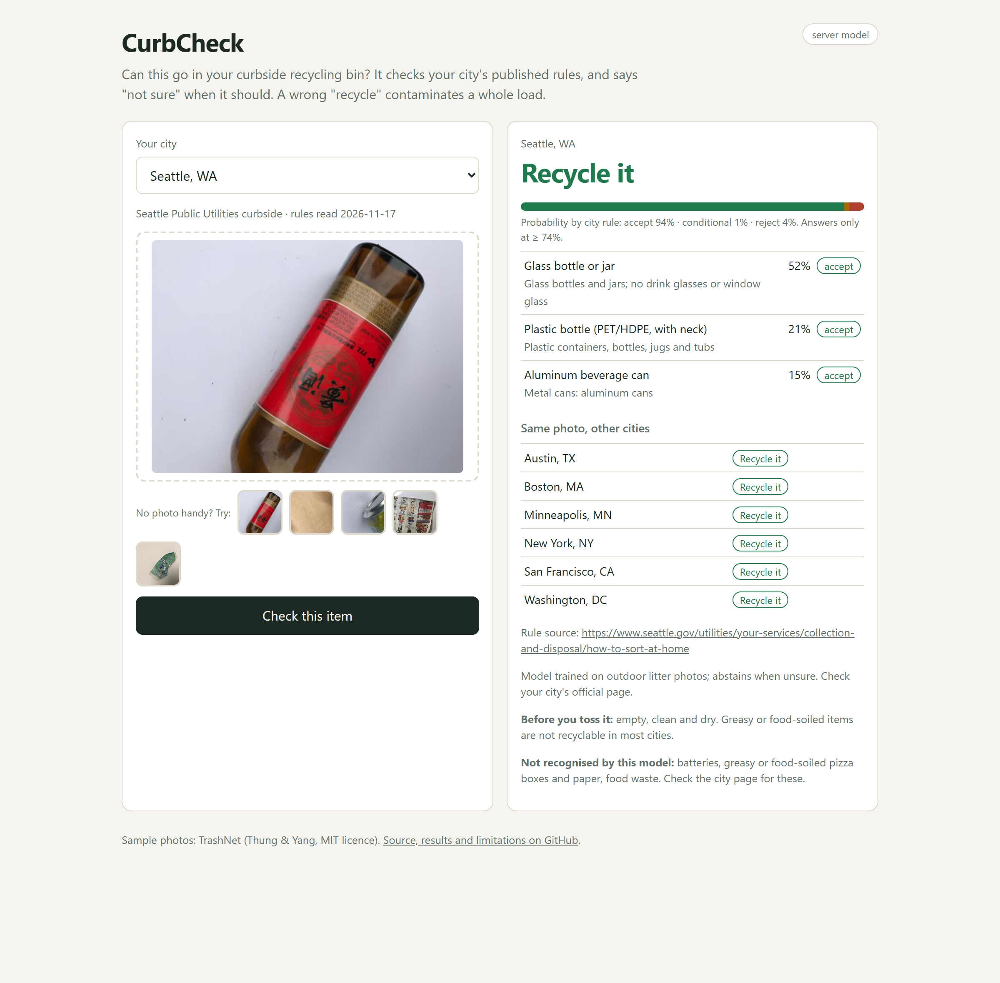
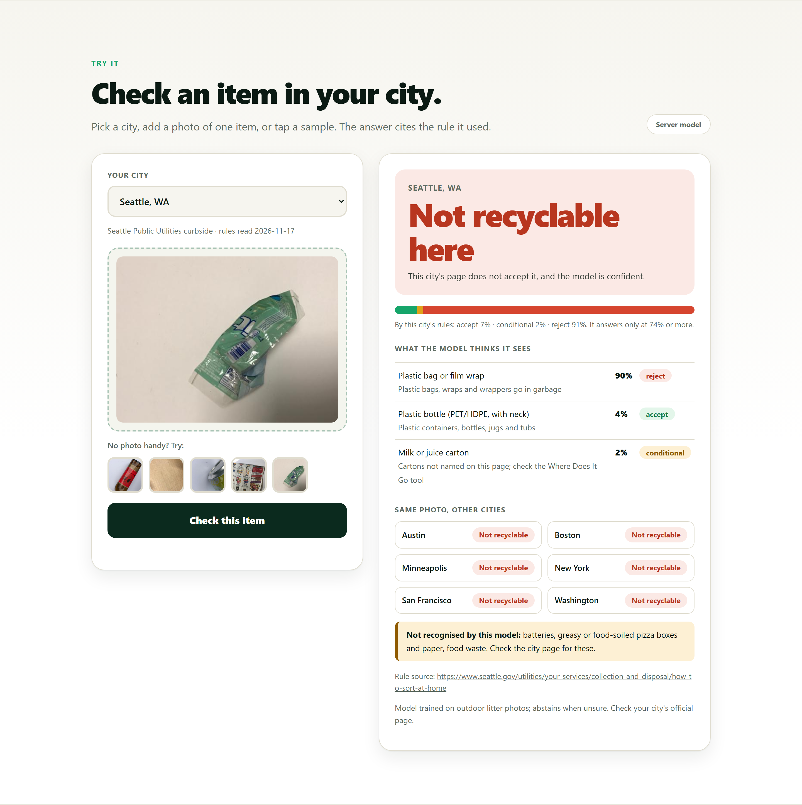
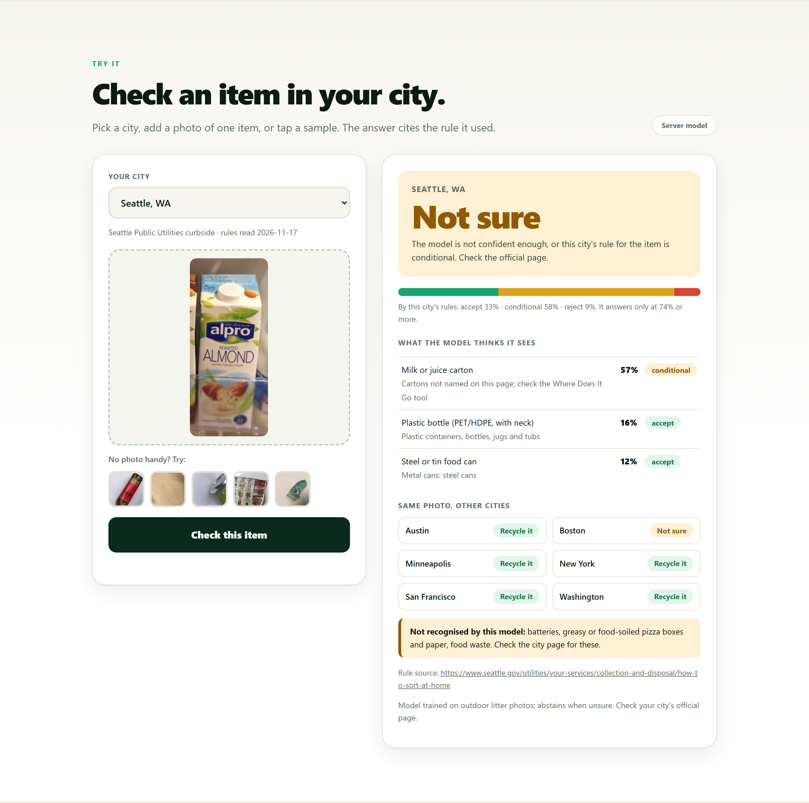
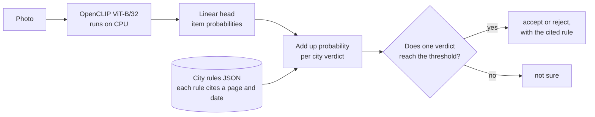

<div align="center">


[](https://github.com/Jean-Regis-M/curbcheck/actions/workflows/ci.yml)
[](https://jean-regis-m.github.io/curbcheck/)
[](https://youtu.be/8sTgR-G_Jro)
[](LICENSE)

**A recycling checker that knows your city's rules, and says "not sure" instead of guessing.**

[Try it in your browser](https://jean-regis-m.github.io/curbcheck/) ·
[Watch the 2 minute demo](https://youtu.be/8sTgR-G_Jro) ·
[Read the technical report (PDF)](docs/report/report.pdf)

*Arbiter Hacks V1, Theme Track: Rethinking Waste*

</div>

---

## The one idea

Put one wrong item in a recycling bin and a whole load can be spoiled. The expensive mistake is therefore the **false accept**: telling someone "recycle it" about something their city will not take.

Most "is this recyclable?" tools give one national yes or no. But the answer is local. These are real differences between the three cities CurbCheck covers, each read from the city's own page:

| Item | Seattle | Washington DC | New York City |
|---|---|---|---|
| Milk or juice carton | page does not name it | accepted | accepted |
| Greasy pizza box | goes to compost, not recycling | page is silent | page is silent |
| Aluminum foil | accepted | page is silent | accepted |
| Plastic tub | accepted | accepted | ice cream tubs excluded |
| Foam, plastic bags | garbage | not accepted | not accepted |

CurbCheck turns that into a tool with two rules:

1. **The answer comes from the city's published rule, and shows its source.** Every rule in the repository carries the URL of the official page and the date it was read.
2. **It only answers when it is confident enough.** Otherwise it says *not sure*, and so does it when the city's page is silent about the item.

That second rule is the product. On held-out photos it cuts false accepts by roughly three quarters while still answering about 70% of the time. It does not make the model smarter. It makes the model's mistakes rarer where they hurt most.

## See it work

| | |
|---|---|
|  **Pick a city, add a photo.** Nothing is uploaded when you use the hosted demo. |  **A confident answer.** A glass bottle in Seattle: recycle it, with the matching rule and its source link. |
|  **A deliberate "not sure".** Cardboard scores 65% accept, below the 71% bar, so it declines. |  **A clear no.** Trash is not recyclable in Seattle. |
|  **Same photo, Seattle.** The city's page does not name cartons, so the rule is *conditional* and the answer is "not sure". |  **Same photo, Washington DC.** DC lists cartons, so the answer is "recycle it". |

The hosted demo also shows the verdict in every other city for the same photo, so the local difference is visible without switching.

## The evidence, including what went wrong

Every number below comes from a script in this repository and a JSON file you can open. Small test sets mean wide error bars; they are stated, not hidden.

**Headline result.** Held-out TACO test, 306 item crops, split by source photo so the same photo never appears in training and testing. The abstention threshold was chosen on a separate validation split. ([`eval/fixed_threshold.json`](eval/fixed_threshold.json))

| City | False-accept rate, forced yes/no | False-accept rate, with abstention | Share of questions answered |
|---|---|---|---|
| Seattle | 13.8% | **3.3%** | 69.6% |
| Washington DC | 12.2% | **3.2%** | 68.6% |

*False accept: the tool said "recycle it" and the city's rule for the true item is not "accept" (a conditional rule counts as not accept).*

**A dataset the shipped model never saw.** TrashNet, 2,045 studio photos, only 137 of them non-recyclable. ([`eval/trashnet.json`](eval/trashnet.json))

| City | Non-recyclables wrongly accepted | 95% interval | Recyclables wrongly rejected | Answered |
|---|---|---|---|---|
| Seattle | 5.8% | 2.2 to 9.4 | 9.1% | 70% |
| Washington DC | 7.3% | 3.1 to 11.7 | 9.1% | 73% |
| New York City | 3.6% | 0.7 to 7.2 | 9.1% | 61% |

**Three things I tried that did not hold up.** I kept them in because they changed what I shipped.

| What I tried | What happened | What I did |
|---|---|---|
| Abstain on the probability of the city's *verdict* instead of on item confidence, expecting a gain. | About the same with the trained model, worse with zero-shot features. ([`eval/results.json`](eval/results.json)) | Dropped the claim that this is the contribution. The gain comes from abstention itself and from tying answers to city rules. |
| Add RealWaste landfill photos (model "v2"). | Missed recyclables on held-out RealWaste fell from 29.8% to 2.2%. But that is adaptation, not generalisation. On unseen TrashNet v2 accepted 12.4% of non-recyclables against 5.8% for v1. ([`eval/v2.json`](eval/v2.json)) | Shipped v1. Kept v2 in the repository. Contamination is the costlier error. |
| Run the same model in the browser for the hosted demo. | The browser pipeline's image features matched PyTorch's at only 0.83 cosine similarity. My first port disagreed with the Python model on 13 of 60 test images. | Retrained the classifier on features computed by the browser pipeline itself, and report its own numbers below. |

**The hosted demo uses its own head.** On the TACO test split, Seattle: false accepts 17.1% forced, 3.9% with abstention, 65.7% answered, 11.7% of recyclables wrongly rejected. This is slightly weaker than the PyTorch model (3.3%, 69.6%, 10.4%). It was *not* re-run on TrashNet or RealWaste. ([`eval/fixed_threshold_web.json`](eval/fixed_threshold_web.json))

## How it works



**Rules.** Each city is a JSON file over a 16-item taxonomy. A rule is `accept`, `reject` or `conditional`. *Conditional* means the city's page does not cover the item; the system will never auto-answer it. Tables are validated by pydantic: every item must be covered and every rule must cite a source. ([`data/rules/`](data/rules), [`src/curbcheck/rules.py`](src/curbcheck/rules.py))

```json
"milk_carton": { "verdict": "accept",
                 "note": "Milk, juice and soup cartons are accepted",
                 "source": 0 }
```

**Decision.** The classifier gives a probability for each item. Items are grouped by what *this city* says about them, and the probabilities in each group are added up. The tool answers `accept` or `reject` only if one group's total reaches the threshold; otherwise `not sure`. Because the threshold applies to the city's verdict and not to a single item, three similar metal items that disagree with each other still produce a confident "accept". ([`src/curbcheck/decision.py`](src/curbcheck/decision.py))

**Model.** OpenAI CLIP ViT-B/32 through OpenCLIP, plus a logistic-regression head trained on 13 item classes from TACO crops. Probabilities are temperature-scaled on a validation split. On a laptop CPU with no GPU, inference took about 92 ms per image.

## Judging criteria, answered one by one

This is the Theme Track rubric from the [Devpost rules](https://arbiter-hacks-v1.devpost.com/rules), with the evidence for each criterion and the gap I would point to myself.

### Impact on the waste problem (35)
- **Central, not bolted on.** The whole product is the contamination decision at the bin. Remove the recycling rules and nothing is left.
- **Measured, within limits.** False accepts fall from 13.8% to 3.3% (Seattle) at 70% coverage on held-out data, and 3.6% to 7.3% on an unseen dataset.
- **How I would measure whether it worked in the real world.** Pick two comparable buildings or routes. Give one the tool and keep one as control. Run bin audits before and after, weighing non-recyclables found in the recycling stream. The target metric is contamination by weight, with the tool's false-accept rate as the leading indicator. **I have not run this.** I make no claim about tonnes diverted or money saved.
- **Gap.** Three cities, curbside only, no household-photo data.

### Technical execution (25)
- **Quality.** 16 automated tests (rules validation, decision logic, API behaviour including bad uploads), linted with ruff, run on every push by [CI](https://github.com/Jean-Regis-M/curbcheck/actions). A fresh clone installs, passes the tests and builds the site.
- **Difficulty.** A rules-grounded decision layer, a three-dataset evaluation split by source photo, two model variants compared on unseen data, and a browser-native port whose feature mismatch I diagnosed and corrected by retraining on the browser's own features.
- **Reproducible.** Every number regenerates from the scripts in [`scripts/`](scripts). Datasets are downloaded by script and never committed.
- **Gap.** Small test sets, wide intervals, and a classifier trained on litter photos, not household items.

### Feasibility (20)
- **Runs cheaply.** CPU only. About 92 ms per image on a laptop. The hosted demo needs no server at all: the model runs in the visitor's browser and the photo stays on their device.
- **Rules are data, not code.** Adding a city means adding one JSON file with cited sources; the validator rejects incomplete tables.
- **What blocks real deployment, stated plainly.** (1) Item-level labelled household photos. Current error rates, especially the 9% to 30% of recyclables wrongly rejected, are too high to ship. (2) Keeping rules current as cities change them. (3) Image dataset licences are unresolved (see [Data](#data-and-licences)).

### Presentation and demo clarity (20)
- A 2 minute 11 second [video](https://youtu.be/8sTgR-G_Jro) recorded from the real running app, including the failure case and the trade-off. Narration is a synthetic voice.
- A live demo a judge can try in one click, with sample photos if none are handy.
- This README, a [3 page technical report](docs/report/report.pdf), and every claim linked to its evidence file.

## Questions I would ask if I were judging this

**Why not just ask a large language model?** Its answer would not cite the city's page, could not be checked against a rule table, and would not be measurable the way a false-accept rate is. A model can still be wrong here; the point is that this one's wrongness is bounded and visible.

**Is 3.3% good?** It is a result on a small litter dataset, and on an unseen dataset it rises to between 3.6% and 7.3%. It is a clear improvement over forcing an answer (about 12% to 20% depending on the dataset), not a deployable error rate.

**Why does it decline so often?** About 30% of questions get "not sure". That is the price of the lower false-accept rate, and it is adjustable: the threshold is a single number chosen on validation data.

**How do you know the rules are right?** I read each city's official page on 2026-11-17 and recorded the URL and date with every rule. Where a page was silent I wrote *conditional* rather than guessing. A rule can still be misread or go out of date, which is why each answer links to its source.

**What did you get wrong along the way?** The three experiments in the table above. They stay in the README because a prototype that hides its failures cannot be trusted.

## Run it yourself

The hosted demo needs nothing. To run the full Python model and API locally:

```bash
git clone https://github.com/Jean-Regis-M/curbcheck.git
cd curbcheck
python -m venv .venv
.venv/Scripts/python -m pip install torch torchvision --index-url https://download.pytorch.org/whl/cpu
.venv/Scripts/python -m pip install -e ".[dev]" open_clip_torch
.venv/Scripts/python -m pytest
.venv/Scripts/python -m uvicorn curbcheck.api:app --port 8000
```

On macOS or Linux use `.venv/bin/python`. Open `http://localhost:8000`. The first request downloads the OpenAI CLIP weights.

To rebuild the evaluation (the scripts download the datasets themselves; images are never committed):

```bash
pip install scikit-learn matplotlib requests pyarrow
python scripts/prepare_taco.py && python scripts/extract_features.py
python scripts/evaluate.py && python scripts/train_head.py
```

The RealWaste and TrashNet checks and the browser head have their own scripts, listed below.

API: `GET /api/health`, `GET /api/cities`, `POST /api/check` (multipart `image` as JPEG, PNG or WebP up to 5 MB, and `city`). It returns the verdict, the probability per verdict, the top three items with their rules, and the source URL.

## Repository map

| Path | What it is |
|---|---|
| [`src/curbcheck/`](src/curbcheck) | Rules validation, decision logic, model wrapper, FastAPI service |
| [`data/rules/`](data/rules) | Seattle, Washington DC and New York City rule tables with sources |
| [`web/`](web) | The single page UI and the in-browser engine used by the hosted demo |
| [`scripts/`](scripts) | Data preparation, training, evaluation, site build, screenshots |
| [`eval/`](eval) | Every result as JSON, plus the false-accept versus coverage chart |
| [`models/`](models) | Trained classifier heads: `head.npz` (shipped, same as `head_v1`), `head_v2`, `head_web` |
| [`tests/`](tests) | 16 tests |
| [`docs/`](docs) | Architecture, data licences, screenshots, the LaTeX report |

Evaluation scripts: `eval_realwaste.py`, `eval_trashnet.py` and `train_v2.py` reproduce the unseen-data and v2 results; `extract_browser_features.py` and `build_site.py` build the hosted demo.

## Security and privacy

- **The hosted demo stores nothing and sends nothing.** The model runs in your browser; the only network traffic is downloading the model and page.
- **The API validates every upload.** It checks the content type, caps uploads at 5 MB, sets Pillow's pixel limit (25 megapixels) as a decompression-bomb guard, rejects unreadable files, and keeps uploads in memory instead of writing them to disk.
- **Not done.** The API has no authentication and no rate limiting, so it is not meant to be exposed publicly as is. I have not had it independently security reviewed.
- **No secrets** are in the repository, and personal research notes are kept out of it.

## Data and licences

| Source | Used for | Licence status |
|---|---|---|
| [TACO](https://github.com/pedropro/TACO) (Proença and Simões, 2020) | Training and the main test split | Code is MIT. Images are Flickr photos under their own free licences. Not redistributed. |
| [TrashNet](https://github.com/garythung/trashnet) (Thung and Yang) | Unseen-data test and sample photos | Repository licence is MIT. |
| [RealWaste](https://archive.ics.uci.edu/dataset/908/realwaste) (Single, Iranmanesh and Raad, 2023) | Second model and stress test | **Conflict:** CC BY 4.0 on UCI, CC BY-NC-SA 4.0 on IEEE DataPort. Treated as non-commercial research use. |
| City recycling pages | Rule tables | Facts read from official pages, each cited with a retrieval date. |
| The Recycling Partnership database | Not used | No download or reuse terms found. |

Full notes in [`docs/DATA.md`](docs/DATA.md). CLIP: Radford et al., 2021, through [OpenCLIP](https://github.com/mlfoundations/open_clip); the browser build uses [transformers.js](https://github.com/huggingface/transformers.js).

## Limitations, in one place

- Trained on litter and landfill photos, not household items. Expect mistakes on real kitchen waste.
- Small test sets. Only 137 non-recyclable images in TrashNet, 306 crops in the main test.
- Batteries and greasy pizza boxes had too few examples to learn; the city tables still cover them.
- Three cities. *Conditional* reflects what the page says, not necessarily the city's real rule.
- 330 TACO annotations were dropped because photo orientation disagreed with the annotation.
- Wrongly rejecting recyclables (9% to 30% depending on dataset) is too high for deployment.
- No measurement of real-world contamination. No claim of environmental or financial impact.

## What comes next

1. Collect and label household photos at the item level. This is the real fix for the missed-recyclable rate.
2. Add machine-readable rules for more cities and a check that flags when a source page changes.
3. Re-run the browser head on the unseen datasets and keep both models in sync.
4. Pilot with a municipality or sorting facility, with bin audits, before any impact claim.

## How this was built

I built CurbCheck for Arbiter Hacks V1 with AI coding assistance (Claude Code). The AI wrote and ran code and scripts under my direction; the numbers in this README come from those scripts, and I kept the failed experiments in the repository. If a number here cannot be regenerated from [`scripts/`](scripts) and [`eval/`](eval), treat that as a bug and open an issue.

## About the builder

I am Jean Francois Regis Mukiza, a student at Fırat University working on cybersecurity and secure AI. I approached this like a security problem: define the failure that matters (a false accept), measure it on data the model has not seen, and publish the negative results.

## Licence

Code: [MIT](LICENSE). Datasets keep their own licences.
