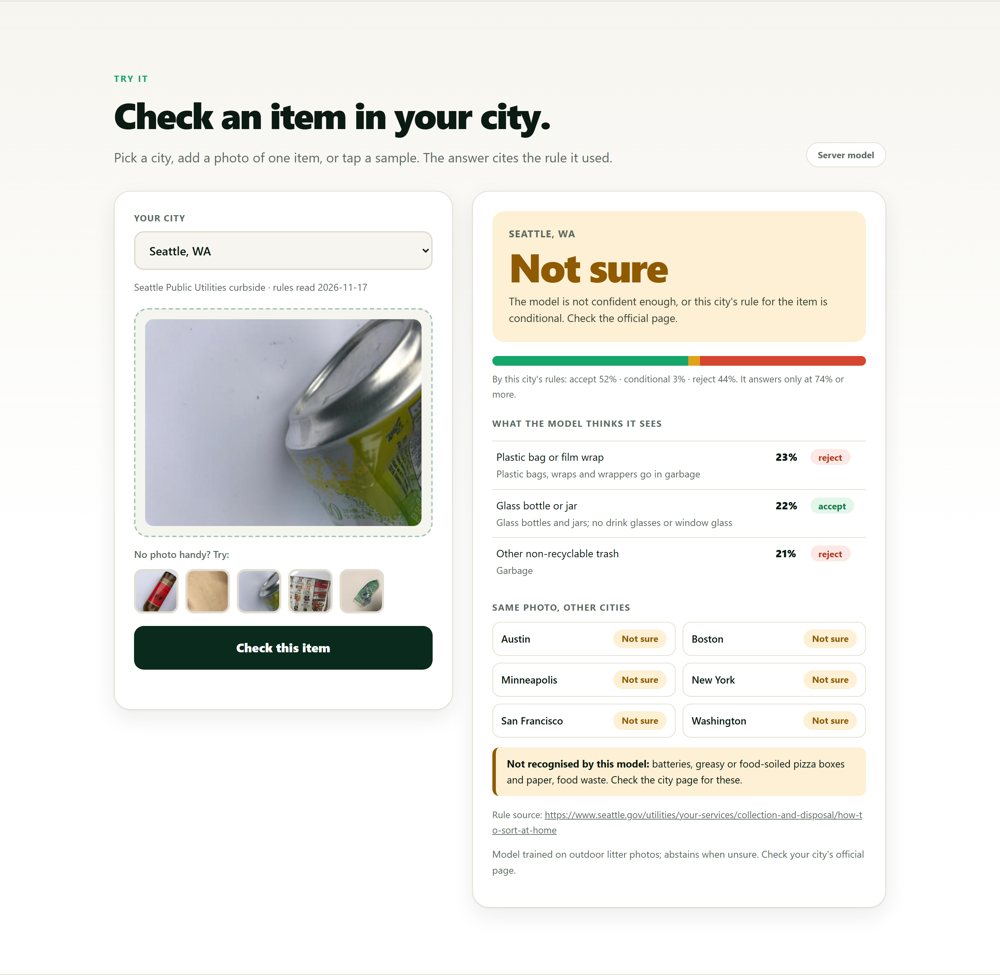
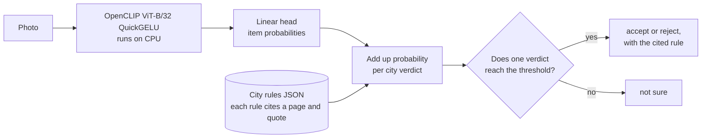

<div align="center">


[](https://github.com/Jean-Regis-M/curbcheck/actions/workflows/ci.yml)
[](https://jean-regis-m.github.io/curbcheck/)
[](https://youtu.be/8sTgR-G_Jro)
[](LICENSE)

**A recycling checker that knows your city's rules, and says "not sure" instead of guessing.**

[Try it in your browser](https://jean-regis-m.github.io/curbcheck/) ·
[Watch the 2 minute demo](https://youtu.be/8sTgR-G_Jro) ·
[Read the technical report (PDF)](docs/report/report.pdf)

*Arbiter Hacks V1, Theme Track: Rethinking Waste*

</div>

---

## The one idea

Put one wrong item in a recycling bin and a whole load can be spoiled. The expensive mistake is the **false accept**: telling someone "recycle it" about something their city will not take.

Most "is this recyclable?" tools give one national yes or no. The answer is local. CurbCheck covers **seven US cities**, and these are real differences between them, each read from the city's own page:

| Item | Seattle | Washington DC | New York | Austin | Minneapolis | Boston | San Francisco |
|---|---|---|---|---|---|---|---|
| Milk or juice carton | page silent | accept | accept | accept | accept | page silent | accept |
| Coffee cup (plastic lined) | page silent | page silent | page silent | accept | **reject** | page silent | accept |
| Greasy pizza box | **reject** (compost) | page silent | page silent | page silent | page silent | page silent | **reject** (compost) |
| Aluminum foil | accept | page silent | accept | accept | accept | accept | accept |
| Plastic tub | accept | accept | ice cream tubs excluded | accept | accept | accept | accept |

Six of the sixteen items in the taxonomy get different answers somewhere in this set. CurbCheck turns that into a tool with two rules:

1. **The answer comes from the city's published rule, and shows its source.** Every rule carries the URL of the official page and the date it was read, and 96 of the 112 rules carry a **verbatim quote** from that page. An audit script re-fetches each page and checks the quote is still there.
2. **It only answers when it is confident enough.** Otherwise it says *not sure*. It also says *not sure* when the city's page is silent about the item.

The second rule is the product. On held-out photos it cuts false accepts by 72% to 93% while still answering about 70% of the time. It does not make the model smarter. It makes the model's mistakes rarer where they hurt most.

## See it work

| | |
|---|---|
|  **Pick a city, add a photo.** Nothing is uploaded when you use the hosted demo. |  **A confident answer.** A glass bottle in Seattle: recycle it, with the matching rule and its source link. |
|  **A deliberate "not sure".** Cardboard scores 65% accept, below the bar, so it declines. |  **A clear no.** Trash is not recyclable in Seattle. |
|  **Same photo, Seattle.** The page does not name cartons, so the rule is *conditional*: "not sure". |  **Same photo, Washington DC.** DC lists cartons: "recycle it". |

The hosted demo also shows the verdict in every other city for the same photo. (Screenshots were taken with the first version of the model; the numbers below are for the current one.)

## The evidence, including what went wrong

Every number below comes from a script in this repository and a JSON file you can open. Small test sets mean wide error bars; they are stated, not hidden. An independent review of the first version found real problems (see [What the review found](#what-an-independent-review-found-and-what-changed)); this section reflects the fixed model.

**Headline result.** Held-out TACO test: 306 item crops, split by source photo so the same photo never appears in training and testing. The abstention threshold was chosen on a separate validation split. ([`eval/fixed_threshold.json`](eval/fixed_threshold.json))

| City | False accepts, forced yes/no | False accepts, with abstention | Share answered | Accept precision | False accepts (count) |
|---|---|---|---|---|---|
| Seattle | 15.8% | **3.3%** | 69.0% | 94.8% | 5 of 152 |
| Washington DC | 12.8% | **1.9%** | 67.6% | 96.8% | 3 of 156 |
| New York City | 12.5% | **2.6%** | 68.3% | 95.8% | 4 of 152 |
| Austin | 10.3% | **0.7%** | 72.2% | 99.1% | 1 of 136 |
| Minneapolis | 12.3% | **3.4%** | 70.9% | 95.0% | 5 of 146 |
| Boston | 15.8% | **3.3%** | 69.0% | 94.8% | 5 of 152 |
| San Francisco | 10.3% | **0.7%** | 72.2% | 99.1% | 1 of 136 |

*False accept: the tool said "recycle it" and the city's rule for the true item is not "accept" (conditional counts as not accept). Accept precision: of the items it told people to recycle, the share that really are accepted. The counts are small, one to five events per city, so treat the percentages as indicative.*

**A dataset the shipped model never saw.** TrashNet: 2,045 studio photos, only 137 of them non-recyclable. ([`eval/trashnet.json`](eval/trashnet.json))

| City | Non-recyclables wrongly accepted | 95% interval | Forced yes/no | Recyclables wrongly rejected | Answered |
|---|---|---|---|---|---|
| New York City | 1.5% (2 of 137) | 0.0 to 3.6 | 11.7% | 8.1% | 55% |
| Seattle | 3.6% (5 of 137) | 0.7 to 7.2 | 16.8% | 8.1% | 65% |
| Boston | 3.6% (5 of 137) | 0.8 to 6.9 | 16.8% | 8.1% | 65% |
| Washington DC | 4.4% (6 of 137) | 1.4 to 7.9 | 16.1% | 8.1% | 67% |
| Minneapolis | 5.1% (7 of 137) | 2.2 to 9.1 | 14.6% | 8.8% | 69% |
| Austin | 9.5% (13 of 137) | 4.7 to 14.1 | 17.5% | 8.1% | 72% |
| San Francisco | 9.5% (13 of 137) | 4.9 to 14.2 | 17.5% | 8.1% | 72% |

Here the city rules matter for safety, not only for the answer: Austin and San Francisco accept more item types (for example coated paper cups), so more of TrashNet's "trash" photos are wrongly accepted there than in New York. Accept precision stays above 98.9% in every city. The intervals treat photos as independent although TrashNet contains near-duplicates, so they are optimistic.

**Four things I tried that did not hold up.** I kept them because they changed what I shipped.

| What I tried | What happened | What I did |
|---|---|---|
| Abstain on the probability of the city's *verdict* instead of on item confidence, expecting a gain. | About the same with the trained model, worse with zero-shot features, across all seven cities. ([`eval/results.json`](eval/results.json)) | Dropped the claim that this is the contribution. The gain comes from abstention itself and from tying answers to city rules. |
| Add RealWaste landfill photos (model "v2"). | Missed recyclables on held-out RealWaste fell from 30.9% to 2.2%, but that is adaptation. On unseen TrashNet v2 wrongly accepted 14% to 19% of non-recyclables against 1.5% to 9.5% for v1, and 63% to 65% when forced. ([`eval/v2.json`](eval/v2.json)) | Shipped v1. Kept v2 in the repository. Contamination is the costlier error. |
| Run the same model in the browser for the hosted demo. | Browser image features match PyTorch's at only 0.84 cosine similarity (int8 quantisation and a different image resizer). My first port disagreed with the Python model on 13 of 60 images. | Retrained the classifier on features computed by the browser pipeline itself, and report its own numbers below. |
| Use the OpenCLIP encoder as I first set it up. | An independent reviewer found I had loaded the OpenAI weights without the QuickGELU activation they were trained with. | Fixed it, re-extracted every feature, retrained and re-ran every evaluation. All numbers in this README are from the fixed encoder. |

**The hosted demo uses its own head.** On the same TACO test split it gets 3.3% to 4.4% false accepts with abstention (5 to 6 events per city) against 13% to 17% forced, answering 63% to 69% of questions, with 9% to 13% of recyclables wrongly rejected. That is slightly weaker than the PyTorch model, and the two can disagree on a single photo. It was *not* re-run on TrashNet or RealWaste. ([`eval/fixed_threshold_web.json`](eval/fixed_threshold_web.json))

## What an independent review found, and what changed

I had a separate reviewer play four skeptical judges (engineer, ML, practitioner, presentation) and review the API's security, without my guidance. It scored the first version about 62 out of 100 and listed verified defects. The full text is kept privately; this is what I did about each one:

| Finding | Change |
|---|---|
| Wrong CLIP activation in the PyTorch path | Fixed and every result regenerated (above). |
| Three high-stakes items (batteries, greasy or food-soiled paper, food waste) are not recognised by the model, so a greasy pizza box can be called cardboard | Every answer now lists these as "not recognised by this model", and "recycle it" answers carry a clean, empty and dry reminder. I did not solve the underlying gap: it needs labelled examples I do not have. |
| Headline rate rested on few events, and the denominator included abstained items | The tables now show the event counts and accept precision (the share of "recycle it" answers that are right). |
| TrashNet is not a clean holdout (v1 versus v2 was chosen after seeing it; near-duplicate photos) | Stated in [`docs/DATA.md`](docs/DATA.md) and above. |
| Hosted demo is not the evaluated model | Described openly above; it has its own measured head. |
| Upload limits did not do what the README said: a 49 megapixel image was accepted, the 5 MB cap applied only after parsing, inference blocked the server's event loop | Oversized bodies are rejected before parsing, the pixel limit is checked from the image header, inference runs in a worker thread, and there is a per-client rate limit of 30 checks a minute. Four new tests cover these. |
| Stale architecture notes and an unsupported "checksums" claim | Rewritten. |
| Rule data is hard to trust | Added verbatim quotes and an audit script (below). |

## How it works



**Rules.** Each city is a JSON file over a 16-item taxonomy. A rule is `accept`, `reject` or `conditional`. *Conditional* means the city's page does not cover the item; the system never auto-answers it. Tables are validated by pydantic: every item must be covered and every rule must cite a source; a test requires every `accept` rule to carry a verbatim quote. ([`data/rules/`](data/rules), [`src/curbcheck/rules.py`](src/curbcheck/rules.py))

```json
"milk_carton": { "verdict": "accept",
                 "note": "Milk, juice and soup cartons are accepted",
                 "source": 0,
                 "quote": "Milk, Juice, & Soup Cartons" }
```

**Rule audit.** `python scripts/verify_rules.py` fetches every cited page (falling back to a headless browser) and checks each quote is still present; a monthly GitHub workflow runs it. All quotes for Seattle, Washington DC, Austin, Minneapolis, Boston and San Francisco pass. New York's site blocks scripted clients, so its quotes were checked by hand against the page on the day I read it.

**Decision.** The classifier gives a probability for each item. Items are grouped by what *this city* says about them, and each group's probabilities are added. The tool answers `accept` or `reject` only if one group's total reaches the threshold; otherwise `not sure`. ([`src/curbcheck/decision.py`](src/curbcheck/decision.py))

**Model.** OpenAI CLIP ViT-B/32 through OpenCLIP, plus a logistic-regression head trained on 13 item classes from TACO crops, temperature-scaled on a validation split. About 92 ms per image on a laptop CPU with no GPU.

## Judging criteria, answered one by one

The Theme Track rubric from the [Devpost rules](https://arbiter-hacks-v1.devpost.com/rules), with the evidence for each criterion and the gap I would point to myself.

### Impact on the waste problem (35)
- **Central, not bolted on.** The whole product is the contamination decision at the bin. Remove the rules and nothing is left.
- **Measured, within limits.** On held-out data, false accepts fall to 0.7% to 3.4% from 10% to 16%, and on an unseen dataset the shipped model's accept precision is above 98.9% in every city.
- **How I would measure whether it worked in the real world.** Pick two comparable buildings or routes, give one the tool, audit bins before and after, and weigh non-recyclables found in the recycling stream. The target is contamination by weight, with the tool's false-accept rate as the leading indicator. **I have not run this.** I make no claim about tonnes diverted or money saved.
- **Gap.** Curbside only, seven cities, no household-photo data.

### Technical execution (25)
- **Quality.** 22 automated tests (rule validation, quote requirements, decision logic, API behaviour including oversized uploads, pixel bombs and rate limiting), ruff, and [CI](https://github.com/Jean-Regis-M/curbcheck/actions) on every push. A fresh clone installs, passes the tests and builds the site.
- **Difficulty.** A rules-grounded decision layer; a rule-audit pipeline that re-checks 96 quotes against live pages; a three-dataset, seven-city evaluation split by source photo; two model variants compared on unseen data; a browser-native port whose feature mismatch I diagnosed and corrected; and an independent review whose findings I fixed and re-measured.
- **Reproducible.** Every number regenerates from [`scripts/`](scripts). Datasets download by script and are never committed.
- **Gap.** Small test sets and a classifier trained on litter photos, not household items.

### Feasibility (20)
- **Runs cheaply.** CPU only, about 92 ms per image. The hosted demo needs no server: the model runs in the visitor's browser and the photo stays on their device.
- **Rules are data, not code.** Adding a city is one JSON file with cited, quoted sources, validated and auditable.
- **What blocks real deployment, plainly.** (1) Item-level labelled household photos. The 8% to 35% of recyclables wrongly rejected is too high to ship. (2) Batteries, greasy paper and food waste are not recognised. (3) Keeping rules current. (4) Image dataset licences are unresolved (see [Data](#data-and-licences)).

### Presentation and demo clarity (20)
- A 2 minute 11 second [video](https://youtu.be/8sTgR-G_Jro) recorded from the real running app, including the failure case. It was recorded before the review fixes, so its numbers are slightly different from the current ones; the narration is a synthetic voice.
- A live demo a judge can try in one click, with sample photos.
- This README, a [3 page report](docs/report/report.pdf), and every claim linked to its evidence file.

## Questions I would ask if I were judging this

**Why not just ask a large language model?** Its answer would not cite the city's page, could not be audited against a rule table, and would not be measurable as a false-accept rate.

**Is 3% good?** On a small litter dataset, yes relative to forcing an answer (10% to 16%). On an unseen dataset it is 1.5% to 9.5% depending on the city. It is a clear improvement, not a deployable error rate.

**Why does it decline so often?** About 30% of questions get "not sure". That is the price of the lower false-accept rate, and it is adjustable: the threshold is one number chosen on validation data.

**How do you know the rules are right?** Each rule cites an official page and, where the page speaks, quotes it. A script re-checks the quotes against the live pages. A rule can still be misread or go stale, which is why every answer links to its source.

**What did you get wrong?** The four experiments above, including an encoder setting an independent reviewer caught. They stay in the README because a prototype that hides its failures cannot be trusted.

## Run it yourself

The hosted demo needs nothing. To run the full Python model and API locally:

```bash
git clone https://github.com/Jean-Regis-M/curbcheck.git
cd curbcheck
python -m venv .venv
.venv/Scripts/python -m pip install torch torchvision --index-url https://download.pytorch.org/whl/cpu
.venv/Scripts/python -m pip install -e ".[dev]" open_clip_torch
.venv/Scripts/python -m pytest
.venv/Scripts/python -m uvicorn curbcheck.api:app --port 8000
```

On macOS or Linux use `.venv/bin/python`. Open `http://localhost:8000`. The first request downloads the OpenAI CLIP weights.

Rebuild the evaluation (scripts download the datasets themselves; images are never committed):

```bash
pip install scikit-learn matplotlib requests pyarrow
python scripts/prepare_taco.py && python scripts/extract_features.py
python scripts/evaluate.py && python scripts/train_head.py
python scripts/verify_rules.py            # audit every rule quote against its page
```

The v2, RealWaste, TrashNet and browser-head scripts are listed in the repository map.

API: `GET /api/health`, `GET /api/cities`, `POST /api/check` (multipart `image` as JPEG, PNG or WebP up to 5 MB, and `city`). It returns the verdict, the probability per verdict, the top three items with their rules, the source URL and a list of items the model cannot recognise.

## Repository map

| Path | What it is |
|---|---|
| [`src/curbcheck/`](src/curbcheck) | Rules validation, decision logic, model wrapper, FastAPI service |
| [`data/rules/`](data/rules) | Seven city rule tables with sources and verbatim quotes |
| [`web/`](web) | The single page UI and the in-browser engine used by the hosted demo |
| [`scripts/`](scripts) | Data preparation, training, evaluation, rule audit, site build, screenshots |
| [`eval/`](eval) | Every result as JSON, plus the false-accept versus coverage chart |
| [`models/`](models) | Trained heads: `head.npz` (shipped, same as `head_v1`), `head_v2`, `head_web` |
| [`tests/`](tests) | 22 tests |
| [`docs/`](docs) | Architecture, data licences, screenshots, the LaTeX report |

Evaluation scripts: `eval_realwaste.py`, `eval_trashnet.py` and `train_v2.py` reproduce the unseen-data and v2 results; `extract_browser_features.py` and `build_site.py` build the hosted demo; `verify_rules.py` audits the rules.

## Security and privacy

- **The hosted demo stores nothing and sends nothing.** The model runs in your browser; the only network traffic is downloading the model and page.
- **The API validates every upload.** It checks content type, rejects oversized bodies before parsing, caps uploads at 5 MB and 25 megapixels (read from the image header), rejects unreadable files, keeps uploads in memory only, runs inference off the event loop, and rate-limits each client to 30 checks a minute.
- **Not done.** No authentication, and the rate limiter is in-memory and per-process, so this is not meant to be exposed publicly as is. The hosted page loads its script from a CDN without integrity pinning. I have not had it independently audited beyond the review above.
- **No secrets** are in the repository history, and personal research notes are kept out of it.

## Data and licences

| Source | Used for | Licence status |
|---|---|---|
| [TACO](https://github.com/pedropro/TACO) (Proença and Simões, 2020) | Training and the main test split | Code is MIT. Images are Flickr photos under their own free licences. Not redistributed. |
| [TrashNet](https://github.com/garythung/trashnet) (Thung and Yang) | Unseen-data test and sample photos | Repository licence is MIT. |
| [RealWaste](https://archive.ics.uci.edu/dataset/908/realwaste) (Single, Iranmanesh and Raad, 2023) | Second model and stress test | **Conflict:** CC BY 4.0 on UCI, CC BY-NC-SA 4.0 on IEEE DataPort. Treated as non-commercial research use. |
| City recycling pages | Rule tables | Facts read from official pages, each cited and quoted. |
| The Recycling Partnership database | Not used | No download or reuse terms found. |

Los Angeles and Chicago were researched and left out because their official pages could not be read or audited reliably. Full notes in [`docs/DATA.md`](docs/DATA.md). CLIP: Radford et al., 2021, through [OpenCLIP](https://github.com/mlfoundations/open_clip); the browser build uses [transformers.js](https://github.com/huggingface/transformers.js).

## Limitations, in one place

- Trained on litter and landfill photos, not household items. Expect mistakes on real kitchen waste.
- Small test sets. Only 137 non-recyclable images in TrashNet and 306 crops in the main test, with one to thirteen false-accept events per city.
- **Batteries, greasy pizza boxes and food waste are not recognised.** The interface says so on every answer; it does not fix it.
- Seven cities. *Conditional* reflects what the page says, not necessarily the city's real rule. NYC's quotes could only be checked by hand.
- 330 TACO annotations were dropped because photo orientation disagreed with the annotation.
- Wrongly rejecting recyclables (8% to 35% depending on dataset) is too high for deployment.
- The demo video predates the encoder fix and shows the earlier numbers.
- No measurement of real-world contamination. No claim of environmental or financial impact.

## What comes next

1. Collect and label household photos at the item level, including batteries, greasy paper and food waste. This is the real fix.
2. More cities, and a check that flags when a source page changes (the monthly audit is the start).
3. Re-run the browser head on the unseen datasets and keep both models in sync.
4. Pilot with a municipality or sorting facility, with bin audits, before any impact claim.

## How this was built

I built CurbCheck for Arbiter Hacks V1 with AI coding assistance (Claude Code). The AI wrote and ran code and scripts under my direction, and separate AI agents researched the city rules and reviewed the project; the numbers in this README come from the scripts, and I kept the failed experiments and the review's findings. If a number here cannot be regenerated from [`scripts/`](scripts) and [`eval/`](eval), treat that as a bug and open an issue.

## About the builder

I am Jean Francois Regis Mukiza, a student at Fırat University working on cybersecurity and secure AI. I approached this like a security problem: define the failure that matters (a false accept), measure it on data the model has not seen, publish the negative results, and have someone else try to break it.

## Licence

Code: [MIT](LICENSE). Datasets keep their own licences.
