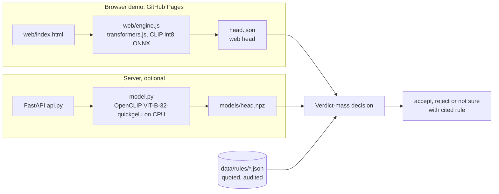

# Architecture

## Components

| Part | File | Notes |
|---|---|---|
| Taxonomy | `src/curbcheck/taxonomy.py` | 16 items shared by the classifier and every city table. |
| Rules | `src/curbcheck/rules.py`, `data/rules/` | pydantic-validated; every item covered; every rule cites a source; verbatim quote where the page speaks. |
| Decision | `src/curbcheck/decision.py` | Sums item probabilities per city verdict; answers only if one verdict reaches the validation-chosen threshold. |
| Model | `src/curbcheck/model.py` | OpenCLIP ViT-B-32-quickgelu (OpenAI weights) plus a linear head; about 90 ms per image on a laptop CPU. |
| API | `src/curbcheck/api.py` | Upload validation, early body-size rejection, per-client rate limit, inference in a worker thread. |
| Browser engine | `web/engine.js` | Same decision logic in JavaScript, with a head trained on browser-computed features. |
| Rule audit | `scripts/verify_rules.py` | Re-fetches each cited page and checks each quote is still present. |

## Two model paths, on purpose

GitHub Pages cannot run Python, so the hosted demo runs CLIP in the browser. Browser features differ from the
PyTorch ones (int8 quantisation and a different image resizer), so the browser has its own head, trained and
thresholded on browser-computed features. The two paths can therefore answer differently on the same photo.

## Evaluation protocol

TACO crops are split by source photo into train, validation and test. The abstention threshold is chosen on
validation only. TrashNet and RealWaste are used as additional tests. See `eval/` and the README.
